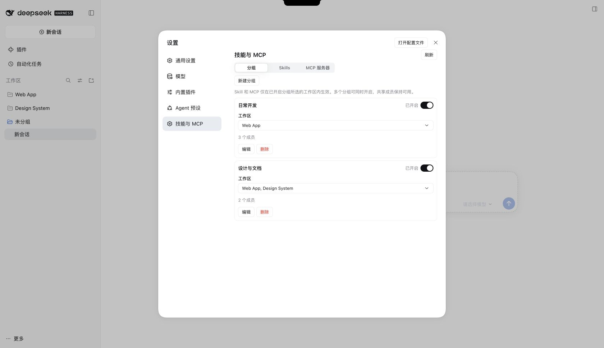

# DeepSeek Harness 技能与 MCP 管理插件


为 DeepSeek Harness 桌面版和 Web 版提供技能与 MCP 图形管理，按分组分配到工作区并统一启停。



## 功能

- 「设置 → 技能与 MCP」管理分组，可同时选择多个工作区、开启多个分组，共享成员保持可用。
- **Skills**：支持单技能目录、多技能目录和 Markdown 导入，保留资源文件；同名不覆盖，删除时显示回收路径。
- **MCP**：支持 stdio、Streamable HTTP、JSON 导入与编辑、连接测试、重连和工具列表。

## 安装

要求 **Harness `>=0.2.1-rc.2 <0.3.0-0`**，支持从 npm 安装或下载安装包。桌面版和 Web 版按 profile 分别安装。

macOS 桌面版先启动一次以初始化配置，再完全退出；须使用应用自带的 CLI，安装位置不同时替换下方路径。

### 从 npm 安装

```sh
# macOS 桌面版
"/Applications/DeepSeek Harness.app/Contents/Resources/runtime/cli/bin/dsh" \
  plugin --profile desktop add dsh-skills-mcp-universal

# Web 版：在服务端安装
dsh plugin --profile web add dsh-skills-mcp-universal
```

### 下载安装

在 [GitHub Actions 的 Build 构建](https://github.com/lynn12866/dsh-skills-mcp-universal/actions/workflows/build.yml)中，打开最新成功的构建，下载 **Artifacts → plugin-package**（需登录 GitHub）。解压 ZIP 得到 `.tgz` 安装包，也可按下方开发命令自行打包。

```sh
# macOS 桌面版：替换为安装包的绝对路径和实际版本
"/Applications/DeepSeek Harness.app/Contents/Resources/runtime/cli/bin/dsh" \
  plugin --profile desktop add file:/absolute/path/dsh-skills-mcp-universal-0.5.2.tgz

# Web 版：将安装包放到服务端，在服务端执行
dsh plugin --profile web add file:/absolute/path/dsh-skills-mcp-universal-0.5.2.tgz
```

安装或更新后重启应用 / Web 服务。覆盖升级时在命令末尾添加 `--force`，原有配置保留；自定义 profile 请替换 `desktop` 或 `web`。

## 限制

- **导入后默认不可调用。** 需创建分组、选择工作区并开启；旧配置迁移后的分组也需手动开启。删除分组保留原条目。
- 开关仅控制本插件管理的条目；关闭 Skill 不会撤回已进入历史对话的正文。
- 已删除或暂不可用的工作区会显示提示并跳过，保留分组与分配；目录恢复后自动重试同步。
- MCP 凭据保存在本地配置文件中；stdio 所需程序与依赖须自行安装。不支持旧版 SSE 传输和 MCP OAuth 登录。
- 不支持技能包内的符号链接或第三方桌面壳；Windows Desktop 尚未实机验证。实测范围见 [验证记录](./VALIDATION.md)。

## 开发与发布

要求 Node.js ≥ 22.19.0、pnpm 11.25.0。

```sh
pnpm install --frozen-lockfile
pnpm check                             # 格式、类型、构建和单元测试
pnpm pack --pack-destination artifacts  # 校验、构建并生成本地安装包
pnpm release:dry-run                    # 校验并预览 npm 包
pnpm release                            # 登录 npm 后校验、构建并发布
```

推送和 Pull Request 会触发 [自动构建](./.github/workflows/build.yml)，检查通过后上传安装包。再次发布前更新 `package.json` 的 `version`；开发规范与发布流程见 [CONTRIBUTING.md](./CONTRIBUTING.md)。

[MIT](./LICENSE)
